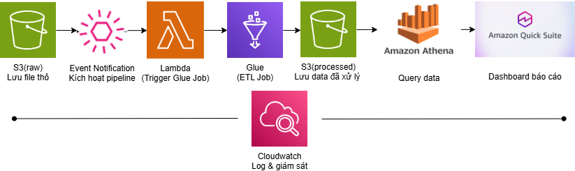
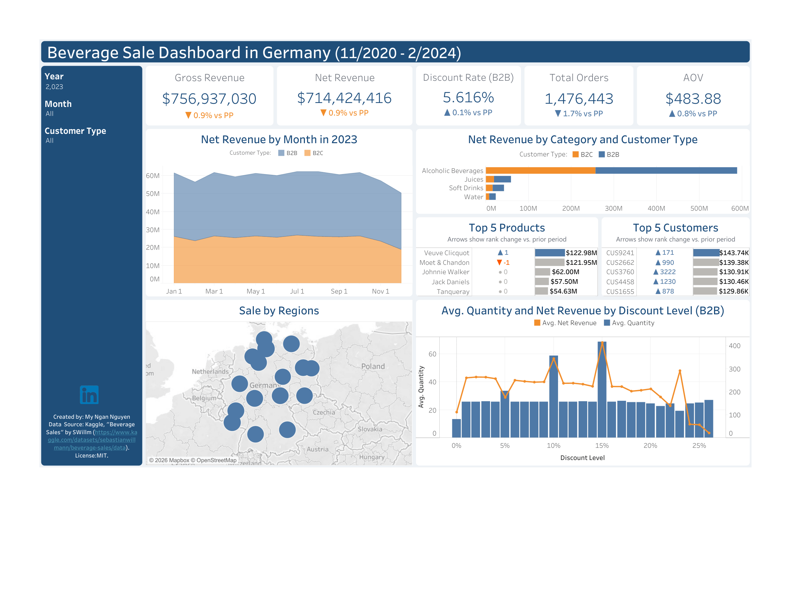

# 🚀 Beverage Sale Analysis

## 🗄️ Data Source

- Kaggle: 'Beverage Sales' by SWillm (simulated data, ~1.1GB)
- Period: 11/2020 – 02/2024, region: Germany
- Link data: https://www.kaggle.com/datasets/sebastianwillmann/beverage-sales/data

## 🏗️ Architecture

---

## 🎥 Demo Video

This demo shows the automated ETL pipeline triggered by S3 events, including Lambda execution, Glue job processing, and querying results in Athena.

[▶️ Watch Demo](https://drive.google.com/file/d/1AaetpZK3k4brSbfcl-PyJ8200B8z8JF9/view)

---

## 📌 Key Insights (2023)

- **Orders and Revenue**
  - Total orders and revenue decreased by about 1.7% and 0.9% respectively compared to 2022, even though the B2B discount rate rose by 0.1 percentage point.
  - A possible reason is that the increase was too small to encourage more purchases, or market demand decreased (further analysis is needed).
  - AOV still increased by 0.8% because total orders dropped more than revenue.
- **Discount Level**
  - Average quantity and revenue were not directly proportional to the discount level (only the 10% and 15% levels stood out).
  - The 23% level brought the most revenue per item, driven by a high unit price rather than high quantity.
- **Net Revenue**
  - Net revenue fluctuated between about $50M and $63M throughout the year and dropped at the end of the year (Nov-Dec).
  - B2B customers generated more net revenue than B2C, but the gap was small (around 58% vs 42% in most months).
  - Net revenue across regions was fairly even (around $41M - $49M each).
- **Category and Product**
  - Alcoholic Beverages generated by far the highest revenue (nearly $600M, approximately 83% of total revenue), with B2B contributing more than B2C in each category.
  - All top 5 products belong to Alcoholic Beverages, led by Veuve Clicquot Champagne (about $123M).

---

## 📊 Dashboard using Tableau

🔗 [View interactive dashboard on Tableau Public](https://public.tableau.com/views/BeverageSaleDashboard/Dashboard)
